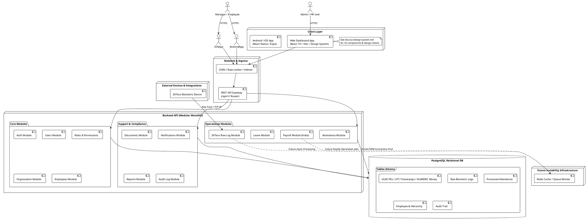

# HRMS Architecture Specification

This document details the high-level system architecture, component interactions, database decisions, integration boundaries, and future scalability roadmap for the HRMS single-company platform.

---

## 1. High-Level PlantUML Architecture Diagram



---

## 2. Architectural Decisions & Rationale

### 2.1 Why Modular Monolith?
- **Single-Company Scope**: For a single-company HRMS, microservice network overhead and distributed transaction complexities (saga patterns, two-phase commits) introduce unnecessary friction.
- **Enforced Module Boundaries**: Code is partitioned into 15 strict modules (`backend/src/modules/`). Each module owns its business domain, controllers, and services.
- **Low Operational Complexity**: Deploys as a single node/container service, reducing infrastructure cost, deployment overhead, and pipeline complexity.
- **Microservices Ready**: When a specific module (e.g., `payroll` or `zkteco`) experiences heavy load, its isolated boundaries enable effortless extraction into an independent microservice.

### 2.2 Why PostgreSQL?
- **Relational Integrity**: HR hierarchy (`Company → Department → Team → Manager → Employee`), RBAC permissions, and payroll structures require strict foreign key constraints, ACID compliance, and relational normalization.
- **UUID Primary Keys**: Native `UUIDv4` primary keys eliminate integer enumeration attacks and facilitate seamless microservices database splitting in the future.
- **Financial Precision (`NUMERIC`)**: Money values (salary breakdowns, PF, ESI, TDS) are stored strictly as `NUMERIC(12, 2)` or `DECIMAL` types to guarantee zero rounding errors.
- **UTC Timestamp Integrity**: All date-time fields use `TIMESTAMPTZ` stored in UTC.

---

## 3. Client Communication Architecture (Web / Android / iOS)

- **Protocol**: Standard HTTP/2 RESTful JSON endpoints prefixed under `/api/v1`.
- **Response Envelope**: Every API endpoint returns a standardized `ApiResponse<T>` or `ApiErrorResponse` payload.
- **Shared Types**: The `@hrms/shared` package serves as a single source of truth for DTOs, request payloads, API status codes, and enums used by Web, Android, iOS, and Backend.

---

## 4. Integration Boundaries

### 4.1 ZKTeco Biometric Integration Boundary
```
[ZKTeco Biometric Machine]
          ↓ (TCP/IP / HTTP Push)
[zkteco Module (Raw Storage)]
          ↓ (Async Event / Cron Worker)
[attendance Module (Calculation Engine)]
          ↓
[Processed Daily Attendance Table]
```
- **Raw Log Preservation**: Raw punch logs (`device_ip`, `user_id`, `punch_timestamp`, `raw_payload`) are ingested directly into the `zkteco` module database tables without modification.
- **No Manual Employee Punching**: Normal employees are strictly prohibited from manually creating standard attendance entries.
- **Decoupled Processing**: The `attendance` module consumes raw logs to calculate daily work duration, tardiness, and overtime.

### 4.2 India Payroll Integration Boundary
- **Monthly Execution**: Payroll runs on a monthly cycle.
- **Taxation & Deductions**: Calculates Provident Fund (PF), Employee State Insurance (ESI), and Tax Deducted at Source (TDS).
- **Extensible Salary Structure**: Salary component breakdowns are maintained as flexible key-value structures (`NUMERIC` values) without forcing fixed assumptions before domain rules are finalized.

---

## 5. Future Scalability & Microservices Migration Strategy

```
Phase 1: Current Modular Monolith (Single PostgreSQL Database)
Phase 2: Add Redis Cache & Async Background Queue (BullMQ for Payroll & Biometric Processing)
Phase 3: Service Extraction (Separate `zkteco` & `payroll` services with dedicated DB schemas)
```
1. **Async Worker Ready**: Heavy tasks (PDF payslip generation, bulk biometric ingestion) use internal event emitters designed for seamless drop-in replacement with Redis/BullMQ.
2. **Schema Separation**: Each module’s database tables are namespaced or prefixed (e.g., `zk_raw_logs`, `pr_payslips`), enabling clean database migration if a module is extracted into its own microservice.
