# HRMS Core PostgreSQL Database Specification & Data Architecture

This document details the PostgreSQL database architecture, schema design, entity relationships, primary & foreign key strategies, indexing, constraints, audit trails, data privacy, and migration workflows for the single-company Human Resource Management System (HRMS).

---

## 1. Database Overview & Technology Stack

- **Database Engine**: PostgreSQL 18.4
- **ORM & Schema Builder**: Drizzle ORM (`drizzle-orm` ^0.38.4, `drizzle-kit` ^0.30.2)
- **Database Driver**: `node-postgres` (`pg` ^8.13.1)
- **Primary Key Strategy**: UUID v4 (`uuid().defaultRandom()`)
- **Timestamp Strategy**: UTC `TIMESTAMPTZ` (`timestamp({ withTimezone: true })`)
- **Currency & Decimal Amounts**: `NUMERIC(12, 2)` (Money precision, avoiding floating-point rounding errors)

---

## 2. Complete Entity-Relationship (ER) Diagram

```plantuml
@startuml HRMS_PostgreSQL_ERD
!theme plain
skinparam linetype ortho
skinparam entity {
  BackgroundColor #1f2937
  BorderColor #4b5563
  FontColor #f9fafb
}

entity "company" as company {
  * id : uuid [PK]
  --
  * name : varchar(255)
  * legal_name : varchar(255)
  * code : varchar(50) [UNIQUE]
  * email : varchar(255)
  * phone : varchar(50)
  * address : text
  * city : varchar(100)
  * state : varchar(100)
  * country : varchar(100)
  * pincode : varchar(20)
  * timezone : varchar(50)
  * currency : varchar(10)
  * status : varchar(20)
  * created_at : timestamptz
  * updated_at : timestamptz
}

entity "company_settings" as company_settings {
  * id : uuid [PK]
  * company_id : uuid [FK, UNIQUE]
  --
  * timezone : varchar(50)
  * currency : varchar(10)
  * date_format : varchar(30)
  * shift_start_time : varchar(10)
  * late_grace_minutes : integer
  * full_day_working_minutes : integer
  * half_day_working_minutes : integer
  * default_casual_leave_days : numeric(5,2)
  * default_sick_leave_days : numeric(5,2)
  * default_earned_leave_days : numeric(5,2)
  * created_at : timestamptz
  * updated_at : timestamptz
}

entity "departments" as departments {
  * id : uuid [PK]
  * company_id : uuid [FK]
  --
  * name : varchar(255)
  * code : varchar(50)
  description : text
  * status : varchar(20)
  * created_at : timestamptz
  * updated_at : timestamptz
  --
  UNIQUE(company_id, code)
}

entity "teams" as teams {
  * id : uuid [PK]
  * department_id : uuid [FK]
  --
  * name : varchar(255)
  * code : varchar(50)
  description : text
  * status : varchar(20)
  * created_at : timestamptz
  * updated_at : timestamptz
  --
  UNIQUE(department_id, code)
}

entity "users" as users {
  * id : uuid [PK]
  --
  * email : varchar(255) [UNIQUE]
  * password_hash : varchar(255)
  * status : varchar(20)
  last_login_at : timestamptz
  * created_at : timestamptz
  * updated_at : timestamptz
}

entity "roles" as roles {
  * id : uuid [PK]
  --
  * name : varchar(50) [UNIQUE]
  description : text
  * is_system : boolean
  * created_at : timestamptz
  * updated_at : timestamptz
}

entity "permissions" as permissions {
  * id : uuid [PK]
  --
  * code : varchar(100) [UNIQUE]
  * module : varchar(50)
  description : text
  * created_at : timestamptz
  * updated_at : timestamptz
}

entity "role_permissions" as role_permissions {
  * role_id : uuid [FK]
  * permission_id : uuid [FK]
  --
  PRIMARY KEY(role_id, permission_id)
}

entity "user_roles" as user_roles {
  * user_id : uuid [FK]
  * role_id : uuid [FK]
  --
  PRIMARY KEY(user_id, role_id)
}

entity "employees" as employees {
  * id : uuid [PK]
  * company_id : uuid [FK]
  user_id : uuid [FK, UNIQUE]
  --
  * employee_code : varchar(50)
  * first_name : varchar(100)
  middle_name : varchar(100)
  * last_name : varchar(100)
  display_name : varchar(255)
  date_of_birth : date
  gender : varchar(20)
  personal_email : varchar(255)
  * work_email : varchar(255) [UNIQUE]
  * phone : varchar(50)
  alternate_phone : varchar(50)
  address : text
  city : varchar(100)
  state : varchar(100)
  pincode : varchar(20)
  emergency_contact_name : varchar(255)
  emergency_contact_phone : varchar(50)
  * joining_date : date
  * employment_status : varchar(30)
  * employment_type : varchar(30)
  * department_id : uuid [FK]
  * team_id : uuid [FK]
  manager_id : uuid [FK]
  * designation : varchar(150)
  date_of_exit : date
  * created_at : timestamptz
  * updated_at : timestamptz
  --
  UNIQUE(company_id, employee_code)
}

entity "employee_manager_history" as mgr_hist {
  * id : uuid [PK]
  * employee_id : uuid [FK]
  * manager_id : uuid [FK]
  --
  * effective_from : timestamptz
  effective_to : timestamptz
  * created_at : timestamptz
}

entity "employee_team_history" as team_hist {
  * id : uuid [PK]
  * employee_id : uuid [FK]
  * team_id : uuid [FK]
  --
  * effective_from : timestamptz
  effective_to : timestamptz
  * created_at : timestamptz
}

entity "employee_documents" as emp_docs {
  * id : uuid [PK]
  * employee_id : uuid [FK]
  --
  * document_type : varchar(50)
  * document_name : varchar(255)
  * storage_key : varchar(512)
  * mime_type : varchar(100)
  * file_size_bytes : bigint
  * uploaded_by : uuid [FK]
  * uploaded_at : timestamptz
  * status : varchar(20)
  * created_at : timestamptz
  * updated_at : timestamptz
}

entity "biometric_devices" as bio_devices {
  * id : uuid [PK]
  * company_id : uuid [FK]
  --
  * name : varchar(100)
  * device_code : varchar(50) [UNIQUE]
  * serial_number : varchar(100) [UNIQUE]
  ip_address : varchar(50)
  port : integer
  location : varchar(255)
  * timezone : varchar(50)
  * status : varchar(20)
  last_sync_at : timestamptz
  * created_at : timestamptz
  * updated_at : timestamptz
}

entity "employee_biometric_mappings" as bio_mappings {
  * id : uuid [PK]
  * employee_id : uuid [FK]
  * device_id : uuid [FK]
  --
  * biometric_user_id : varchar(50)
  * created_at : timestamptz
  * updated_at : timestamptz
  --
  UNIQUE(device_id, biometric_user_id)
}

entity "attendance_raw_logs" as raw_logs {
  * id : uuid [PK]
  * device_id : uuid [FK]
  --
  * biometric_user_id : varchar(50)
  * punch_time : timestamptz
  punch_type : varchar(20)
  raw_event_id : varchar(100)
  raw_payload : text
  * received_at : timestamptz
  * source : varchar(50)
  * processing_status : varchar(20)
  processed_at : timestamptz
  error_message : text
  * created_at : timestamptz
  --
  UNIQUE(device_id, biometric_user_id, punch_time)
}

entity "attendance_records" as att_records {
  * id : uuid [PK]
  * employee_id : uuid [FK]
  --
  * attendance_date : date
  check_in_at : timestamptz
  check_out_at : timestamptz
  working_minutes : integer
  * late_minutes : integer
  * early_exit_minutes : integer
  * overtime_minutes : integer
  * status : varchar(30)
  * source : varchar(30)
  remarks : text
  * created_at : timestamptz
  * updated_at : timestamptz
  --
  UNIQUE(employee_id, attendance_date)
}

entity "attendance_corrections" as att_corr {
  * id : uuid [PK]
  * attendance_record_id : uuid [FK]
  * requested_by : uuid [FK]
  approved_by : uuid [FK]
  --
  original_check_in_at : timestamptz
  original_check_out_at : timestamptz
  corrected_check_in_at : timestamptz
  corrected_check_out_at : timestamptz
  original_status : varchar(30)
  corrected_status : varchar(30)
  * reason : text
  * status : varchar(20)
  * created_at : timestamptz
  approved_at : timestamptz
}

entity "leave_types" as leave_types {
  * id : uuid [PK]
  * company_id : uuid [FK]
  --
  * name : varchar(100)
  * code : varchar(50)
  description : text
  default_days : numeric(5,2)
  * is_paid : boolean
  * status : varchar(20)
  * created_at : timestamptz
  * updated_at : timestamptz
  --
  UNIQUE(company_id, code)
}

entity "leave_balances" as leave_balances {
  * id : uuid [PK]
  * employee_id : uuid [FK]
  * leave_type_id : uuid [FK]
  --
  * year : numeric(4,0)
  * allocated_days : numeric(5,2)
  * used_days : numeric(5,2)
  * pending_days : numeric(5,2)
  * carried_forward_days : numeric(5,2)
  * created_at : timestamptz
  * updated_at : timestamptz
  --
  UNIQUE(employee_id, leave_type_id, year)
}

entity "leave_requests" as leave_requests {
  * id : uuid [PK]
  * employee_id : uuid [FK]
  * leave_type_id : uuid [FK]
  --
  * start_date : date
  * end_date : date
  * requested_days : numeric(5,2)
  * reason : text
  attachment_key : varchar(512)
  * status : varchar(20)
  * submitted_at : timestamptz
  cancelled_at : timestamptz
  * created_at : timestamptz
  * updated_at : timestamptz
}

entity "leave_approvals" as leave_approvals {
  * id : uuid [PK]
  * leave_request_id : uuid [FK, UNIQUE]
  * approver_user_id : uuid [FK]
  --
  * approver_role : varchar(30)
  * decision : varchar(20)
  comment : text
  * decided_at : timestamptz
  * created_at : timestamptz
}

entity "payroll_periods" as payroll_periods {
  * id : uuid [PK]
  * company_id : uuid [FK]
  --
  * year : integer
  * month : integer
  * start_date : date
  * end_date : date
  * status : varchar(20)
  * created_at : timestamptz
  * updated_at : timestamptz
  --
  UNIQUE(company_id, year, month)
}

entity "payroll_runs" as payroll_runs {
  * id : uuid [PK]
  * payroll_period_id : uuid [FK]
  --
  * started_at : timestamptz
  completed_at : timestamptz
  * status : varchar(20)
  * processed_by : uuid [FK]
  remarks : text
  * created_at : timestamptz
  * updated_at : timestamptz
}

entity "payroll_items" as payroll_items {
  * id : uuid [PK]
  * payroll_run_id : uuid [FK]
  * employee_id : uuid [FK]
  --
  * gross_amount : numeric(12,2)
  * total_deductions : numeric(12,2)
  * net_amount : numeric(12,2)
  * status : varchar(20)
  * created_at : timestamptz
  * updated_at : timestamptz
}

entity "payroll_deductions" as payroll_deductions {
  * id : uuid [PK]
  * payroll_item_id : uuid [FK]
  --
  * type : varchar(50)
  * amount : numeric(12,2)
  description : text
  * created_at : timestamptz
}

entity "payroll_taxes" as payroll_taxes {
  * id : uuid [PK]
  * payroll_item_id : uuid [FK]
  --
  * tax_type : varchar(50)
  * amount : numeric(12,2)
  description : text
  * created_at : timestamptz
}

entity "payslips" as payslips {
  * id : uuid [PK]
  * payroll_item_id : uuid [FK, UNIQUE]
  * employee_id : uuid [FK]
  * payroll_period_id : uuid [FK]
  --
  * payslip_number : varchar(100) [UNIQUE]
  * generated_at : timestamptz
  storage_key : varchar(512)
  * status : varchar(20)
  * created_at : timestamptz
}

entity "notifications" as notifications {
  * id : uuid [PK]
  * user_id : uuid [FK]
  --
  * type : varchar(50)
  * title : varchar(255)
  * message : text
  data_reference : text
  read_at : timestamptz
  * created_at : timestamptz
}

entity "audit_logs" as audit_logs {
  * id : uuid [PK]
  actor_user_id : uuid [FK]
  --
  * action : varchar(100)
  * entity_type : varchar(50)
  * entity_id : varchar(100)
  old_values_json : text
  new_values_json : text
  ip_address : varchar(50)
  user_agent : text
  * created_at : timestamptz
}

' Relationships
company ||--o{ departments
departments ||--o{ teams
company ||--|| company_settings

users ||--o| employees
employees ||--o{ mgr_hist
employees ||--o{ team_hist
employees ||--o{ emp_docs

roles ||--o{ role_permissions
permissions ||--o{ role_permissions
users ||--o{ user_roles
roles ||--o{ user_roles

company ||--o{ bio_devices
bio_devices ||--o{ bio_mappings
employees ||--o{ bio_mappings
bio_devices ||--o{ raw_logs

employees ||--o{ att_records
att_records ||--o{ att_corr

company ||--o{ leave_types
employees ||--o{ leave_balances
leave_types ||--o{ leave_balances
employees ||--o{ leave_requests
leave_types ||--o{ leave_requests
leave_requests ||--o| leave_approvals

company ||--o{ payroll_periods
payroll_periods ||--o{ payroll_runs
payroll_runs ||--o{ payroll_items
employees ||--o{ payroll_items
payroll_items ||--o{ payroll_deductions
payroll_items ||--o{ payroll_taxes
payroll_items ||--o| payslips

users ||--o{ notifications
users ||--o{ audit_logs

@endl
```



---

## 3. Database Design Principles & Constraints

### 3.1 Primary & Foreign Keys
1. **Primary Keys**: Every table uses a `uuid` primary key generated via native `gen_random_uuid()` (`uuid().defaultRandom()`).
2. **Foreign Key Integrity**: Restrict destructive cascades (`onDelete: 'restrict'`) on master data (Company, Department, Employee, Users) to protect financial and historical records. Use `cascade` only on pure child entities (such as `role_permissions`, `user_roles`, `leave_balances`, `payroll_items`).

### 3.2 Key Indexes
- `idx_emp_company_code`: `company_id + employee_code` (Unique)
- `idx_dept_company_code`: `company_id + code` (Unique)
- `idx_team_dept_code`: `department_id + code` (Unique)
- `idx_bio_map_dev_user`: `device_id + biometric_user_id` (Unique)
- `idx_raw_log_dev_user_punch`: `device_id + biometric_user_id + punch_time` (Unique)
- `idx_att_emp_date`: `employee_id + attendance_date` (Unique)
- `idx_leave_bal_emp_type_year`: `employee_id + leave_type_id + year` (Unique)
- `idx_pay_period_company_yr_mth`: `company_id + year + month` (Unique)
- `idx_notif_user_read`: `user_id + read_at`
- `idx_audit_actor`, `idx_audit_entity`, `idx_audit_created`: For security queries.

---

## 4. Historical Tracking & Soft Delete Policy

1. **No Physical Record Deletion**: HRMS employee profiles, attendance logs, leave records, and payslips must never be physically deleted from PostgreSQL.
2. **Manager & Team History**:
   - `employee_manager_history`: Tracks manager changes over time (`effective_from`, `effective_to`).
   - `employee_team_history`: Tracks department & team transfers over time (`effective_from`, `effective_to`).
3. **Status Flags**: Master records use explicit status fields (`ACTIVE`, `PROBATION`, `NOTICE_PERIOD`, `TERMINATED`, `RESIGNED`) rather than `deleted_at` columns.

---

## 5. Data Privacy & PII Handling

1. **PII Isolation**: Personal Identifiable Information (PII) such as personal email, phone numbers, and emergency contact details are restricted to HR and Employee self-service roles via RBAC permissions.
2. **File Storage Isolation**: Binary documents (PDFs, identity proofs, payslips) are **never** stored in PostgreSQL. Database tables (`employee_documents`, `payslips`) store only metadata and secure object storage keys (`storage_key`).
3. **Audit Trails**: Sensitive mutations (role updates, leave approvals, attendance corrections) generate immutable records in `audit_logs` capturing `actor_user_id`, `ip_address`, `action`, `old_values_json`, and `new_values_json`.

---

## 6. Migration & Setup Commands

```bash
# Generate SQL Migration from Drizzle schemas
npm run db:generate --workspace=backend

# Programmatically run pending database migrations
npm run db:migrate --workspace=backend

# Seed development company, departments, teams, roles, permissions, and demo employees
npm run db:seed --workspace=backend

# Run database constraint unit tests
npm run test --workspace=backend
```
