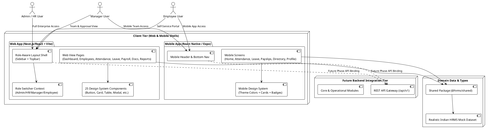

# HRMS UI/UX Design System Specification

This document details the single-company HRMS design system, component architecture, color tokens, layout hierarchy, role-aware routing, and web-mobile relationship.

---

## 1. UI/UX Architecture & Interaction Diagram

---

## 2. Design Principles

1. **Clean & Enterprise Minimalist**: Serious enterprise aesthetic designed for high data readability, uncluttered forms, and consistent tables. Avoids glassmorphism overload, excessive gradients, or playful non-standard UI patterns.
2. **Role-Aware Context**: The UI automatically morphs and filters navigation options based on the active user role (`Admin`, `HR`, `Manager`, `Employee`).
3. **Responsive & Mobile-First**: Mobile drawer layouts and compact React Native screens deliver native touch interactions without simple screen scaling.
4. **Accessible & High-Contrast**: Form inputs feature clear labels, required markers (`*`), error messages, keyboard navigation outlines (`Ctrl+K` global search), and ARIA landmark compliance.

---

## 3. Color System Tokens (Light & Dark Themes)

Design tokens are centralized in CSS variables ([index.css](file:///c:/HRMS/web/src/styles/index.css)) and React Native Theme ([colors.ts](file:///c:/HRMS/mobile/src/theme/colors.ts)):

| Token Name | Dark Theme | Light Theme | Usage |
| :--- | :--- | :--- | :--- |
| `--bg-app` | `#0b0f19` | `#f8fafc` | Main application backdrop |
| `--bg-surface` | `#111827` | `#ffffff` | Card, Table, & Modal surfaces |
| `--border-color` | `rgba(255,255,255,0.08)` | `#e2e8f0` | Dividers & container borders |
| `--primary-500` | `#6366f1` | `#4f46e5` | Primary brand accent (Indigo) |
| `--text-primary` | `#f9fafb` | `#0f172a` | Primary text headings |
| `--success-text` | `#34d399` | `#047857` | Present status / Paid payroll |
| `--warning-text` | `#fbbf24` | `#b45309` | Late punch / Pending leave |
| `--error-text` | `#f87171` | `#b91c1c` | Absent status / Missing punch |

---

## 4. Reusable 25 Component System

The design system provides 25 core components under `web/src/components/ui/`:

1. `Button`: 5 variants (primary, secondary, outline, danger, ghost), 3 sizes (sm, md, lg), loading spinner states.
2. `Input`: Standard input field with labels, required indicators, error text, and icon support.
3. `Select`: Single select component with option mapping and error validation.
4. `DatePicker`: Date input wrapper with calendar icon.
5. `SearchInput`: Search bar with clear button (`X`).
6. `Table`: Compound table suite (`TableContainer`, `Table`, `Thead`, `Tbody`, `Tr`, `Th`, `Td`).
7. `Pagination`: Entry range indicator and page switching buttons.
8. `Tabs`: Tab header list with active indicators and count badges.
9. `Card`: Card container with `CardHeader`, `CardTitle`, `CardBody`, `CardFooter`.
10. `Badge`: Status pill (`success`, `warning`, `error`, `info`, `neutral`).
11. `Alert`: Status banner with icon and dismiss trigger.
12. `Toast`: Global notification toast stack.
13. `Modal`: Dialog popup with backdrop blur and escape key listener.
14. `Drawer`: Side drawer for detail feeds and notification center.
15. `Dropdown`: Context menu dropdown with positioning.
16. `Avatar`: User photo with initials fallback and online status indicator.
17. `EmptyState`: Empty dataset placeholder with icon, title, description, and action button.
18. `LoadingSpinner`: CSS keyframe spinner.
19. `Skeleton`: Table, card, and form placeholder loading skeletons.
20. `ErrorState`: Error boundary state with retry trigger.
21. `ConfirmDialog`: Confirmation dialog for destructive actions.
22. `FormSection`: Form group section with title, description, and bottom border divider.
23. `StatCard`: KPI stat card with icon, value, change indicator, and subtext.
24. `Breadcrumbs`: Navigation breadcrumb path.
25. `Tooltip`: Hover tooltip container.

---

## 5. Web/Mobile Role Navigation Strategy

### Role Navigation Matrix

- **Admin**: Full access (Dashboard, Employees, Departments, Teams, Attendance, Leave, Payroll, Documents, Reports, Users & Roles, Settings, Audit Logs).
- **HR**: Operational access (Dashboard, Employees, Departments, Teams, Attendance, Leave, Payroll, Documents, Reports, Settings).
- **Manager**: Team scope (Dashboard, My Team, Team Attendance, Leave Requests, Reports, My Profile).
- **Employee**: Self-service scope (Dashboard, My Profile, My Attendance, My Leave, My Documents, My Payslips).

---

## 6. Verification & Build Results

All workspaces compile with 0 errors:
- `@hrms/shared`: ESM TypeScript build complete.
- `web`: Vite production bundle generated (`dist/assets/index-D4UbLzyh.js`).
- `mobile`: React Native TypeScript `tsc --noEmit` check passed cleanly.
